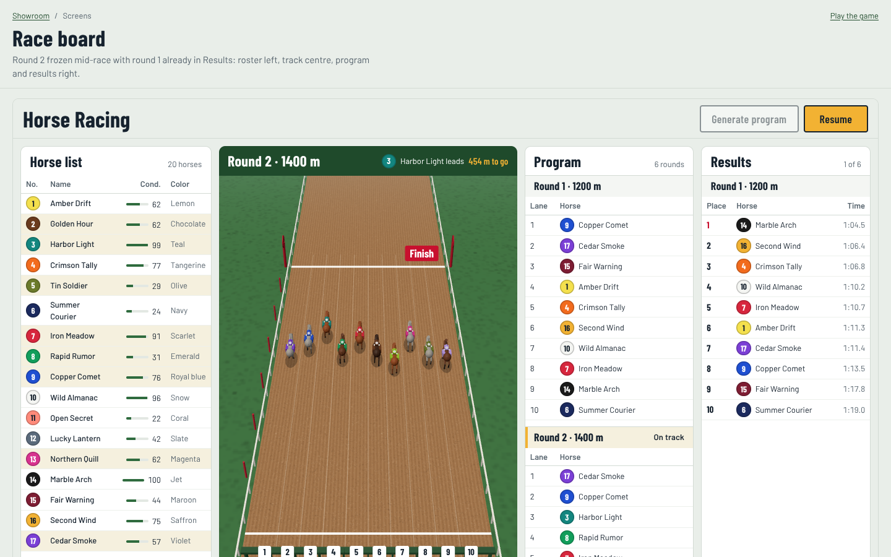

# Horse Racing

A six-round horse race you can watch from the grandstand: twenty horses, ten per round, running up a 3D straight from the starting gate to the finish post. Built with Vue 3, Pinia and Three.js for the Insider One front-end case study.

**[Play the demo](https://OWNER.github.io/horse-racing/)** · **[Open the showroom](https://OWNER.github.io/horse-racing/#/showroom)**



## Try it in 60 seconds

1. Press **Generate program**. Six rounds of ten horses are drawn; round 1 lines up at the gate.
2. Press **Start**. The field gallops up the screen. The strip under the track shows the live order.
3. Press **Pause**, then **Resume**. Horses freeze mid-stride and carry on from the same spot.
4. When the tenth horse crosses the line, the round's full finishing order appears in **Results**, and the next round starts by itself.

To skip the wait, open a state directly:
[running](https://OWNER.github.io/horse-racing/#/showroom/states/running) ·
[after round 1](https://OWNER.github.io/horse-racing/#/showroom/states/after-round-1) ·
[completed](https://OWNER.github.io/horse-racing/#/showroom/states/completed) ·
[one horse](https://OWNER.github.io/horse-racing/#/showroom/horses/h01)

Add `?seed=1234` before the `#` to replay the same horses, program and race. Add `?track=html` to see the lightweight track used when WebGL is not available.

## Run locally

Requires Node 22 (see `.nvmrc`) and npm. The lockfile is `package-lock.json`.

```bash
npm ci
npm run dev                 # http://localhost:5173
```

For the end-to-end and visual tests, install Playwright's Chromium once:

```bash
npx playwright install --with-deps chromium
```

## How it works

- **Horses.** 20 per session, each with a stable id and saddle-cloth number (1–20), a unique name, a unique colour from a 20-colour palette, and an integer condition from 1 to 100.
- **Program.** Six rounds at 1200, 1400, 1600, 1800, 2000 and 2200 m. Each round draws 10 different horses from the 20 (Fisher–Yates); the draw order is the lane order. A horse can run in more than one round. The program does not change during the race.
- **Pace.** When a round starts, each runner gets a speed of `15 + 3 × condition/100 + form` m/s, with `form` uniform in ±1 m/s, plus a gentle surge-and-fade wave so the order shuffles along the way:

  `v(t) = b · (1 + a · sin(ωt + φ))`, so `d(t) = b · (t − (a/ω)(cos(ωt + φ) − cos φ))`

  A better condition helps but does not guarantee a win. Longer rounds take longer.
- **Clock.** One race clock in the store, in simulated seconds. The animation loop feeds it real elapsed time × 10, so 1200 m takes about 7 seconds on screen. Each frame's step is capped at 0.1 s, and the result does not depend on frame rate: a 30 fps and a 144 fps run give identical results (unit-tested).
- **Finishing order.** Each runner's exact crossing time is solved from the formula, so two horses that cross within the same frame still place correctly. An exact tie goes to the lower lane.
- **Results.** A round's ten placings are published once, the moment the tenth horse crosses. After a 1.5 s pause on the finished field, the next round starts. After round 6 the race stops.
- **Pause.** Pausing stops the clock; no time is added for the pause. Switching to another tab or leaving for the showroom also pauses, and **Resume** continues from the same positions.
- **Randomness.** Seedable PRNG (mulberry32). Normal sessions use a random seed; the same seed and the same elapsed time always give the same program, positions and results.

## Architecture and assumptions

```
src/domain/        Pure TypeScript rules: horses, program, pace model, ranking, RNG. No Vue, no DOM.
src/stores/race.ts Pinia store: game state machine and the single race clock.
src/components/    Vue components: RaceControls, HorseRoster, RaceTrack, RoundProgram, RoundResults, RaceBoard.
src/three/         Three.js: track scene, procedural horse model, poses. Reads positions; never decides them.
src/showroom/      Fixtures and the page manifest. src/views/showroom/ renders them.
```

Data flows one way: **domain → store → components → scene**. The store owns state; components show it and send user actions back; the 3D scene turns metres into world coordinates and a gallop pose. The track and the Results panel read the same runners, so the picture and the table cannot disagree.

| State | Generate | Start / Pause / Resume |
|---|---|---|
| Idle | enabled | disabled |
| Ready | enabled (redraws the program) | Start |
| Running | disabled | Pause |
| Paused | disabled | Resume |
| Completed | enabled (new program, same 20 horses, results cleared) | disabled |

Guards live in the store, so repeated clicks cannot start a second loop or publish a round twice. The loop (`useRaceLoop`) runs only while the store says `running` and is cancelled when its component unmounts.

**3D.** The horse and jockey are built from Three.js primitives at runtime: no external model, texture or licence. All horses share one set of geometries and materials; each horse only adds its own transforms, saddle-cloth colour and number. The gallop pose is a function of distance covered, not wall time, so the same race moment always draws the same frame and a paused horse is frozen mid-stride. With `prefers-reduced-motion`, leg movement is damped while positions and results update as usual. Three.js objects are kept outside Vue's reactivity and disposed when the last user unmounts. If WebGL cannot start, the app shows a numbered HTML track fed by the same data, and the race can be completed there.

**Assumptions.**
- The brief says "between 1 to 20 horses" but also "a total of 20 horses" and "select 10 … from the available 20", so the session always has exactly 20 horses.
- An exact tie in crossing time is resolved by the lower lane.
- Generate is available before the start and after the last round; during a race it is disabled.

## Verification

```bash
npm run typecheck           # vue-tsc, strict
npm run test:unit           # Vitest: domain, store, track mapping, components
npm run build               # production build to dist/
npm run test:e2e            # Playwright against dist/ served at /horse-racing/
npm run test:visual         # Playwright screenshot comparison
npm run test:visual:update  # deliberately regenerate baselines
```

- **Domain tests** check the 20-horse pool, condition bounds, six exact distances, ten distinct horses per round, repeatability by seed, that horses stop at the line, same-frame finishes and tie-breaks, and that ranking never mutates the program.
- **Store tests** check the state machine, that Pause freezes everything, that nine finishers publish nothing and the tenth publishes one group, 6 × 10 results, and identical results at 30 and 144 fps.
- **Component tests** check button states and emitted actions, empty and filled Results, and that each lane in Program shows the horse the store placed there.
- **E2E** drives the full flow with a controlled clock (no sleeps): Generate → Start → movement in at least two lanes → Pause (nothing moves) → Resume → first result → automatic rounds → 60 results matching the program → Generate again. It also checks the WebGL canvas changes while running and stays still while paused, the HTML fallback when WebGL is blocked, every showroom URL directly and after refresh, and mobile layout.
- **Visual** compares showroom pages at 1440 × 900 and 390 × 844 against committed baselines, using a fixed seed, fixed viewport and software WebGL.

Visual baselines were generated with Playwright 1.63's Chromium on Linux. If the CI container renders a few pixels differently, run the workflow manually with **update_baselines**, download the `visual-baselines` artifact and commit it.

## Showroom and assets

The [showroom](https://OWNER.github.io/horse-racing/#/showroom) gives every screen, state, component and visual its own URL, built from one fixed seed:
screens (`race-board`), states (`idle`, `ready`, `running`, `paused`, `after-round-1`, `completed`), components (`controls`, `horse-roster`, `race-track`, `round-program`, `round-results`), visuals (`galloping-horse`, `silks-lineup`, `html-track`) and twenty horse pages (`h01`–`h20`).

All visuals are original and drawn in code. Fonts: Barlow and Barlow Condensed (SIL Open Font License), bundled through `@fontsource`.

## Deployment

GitHub Pages, source: **GitHub Actions** (`.github/workflows/ci.yml`). Every pull request runs install, typecheck, unit tests, build, E2E and visual tests. A push to `main` runs the same checks and deploys that exact `dist/` to Pages.

The build uses relative asset paths and hash routing, so it works at `/horse-racing/` or any other repository path without changes. To preview the production build under that path:

```bash
npm run build && npm run serve    # http://localhost:4173/horse-racing/
```
